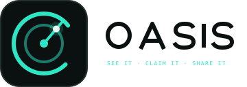
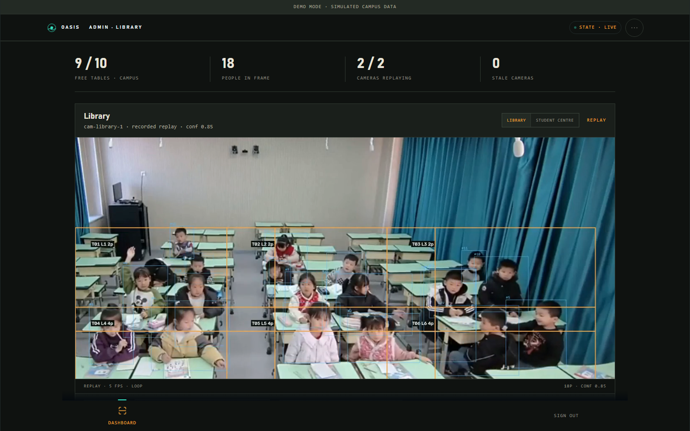
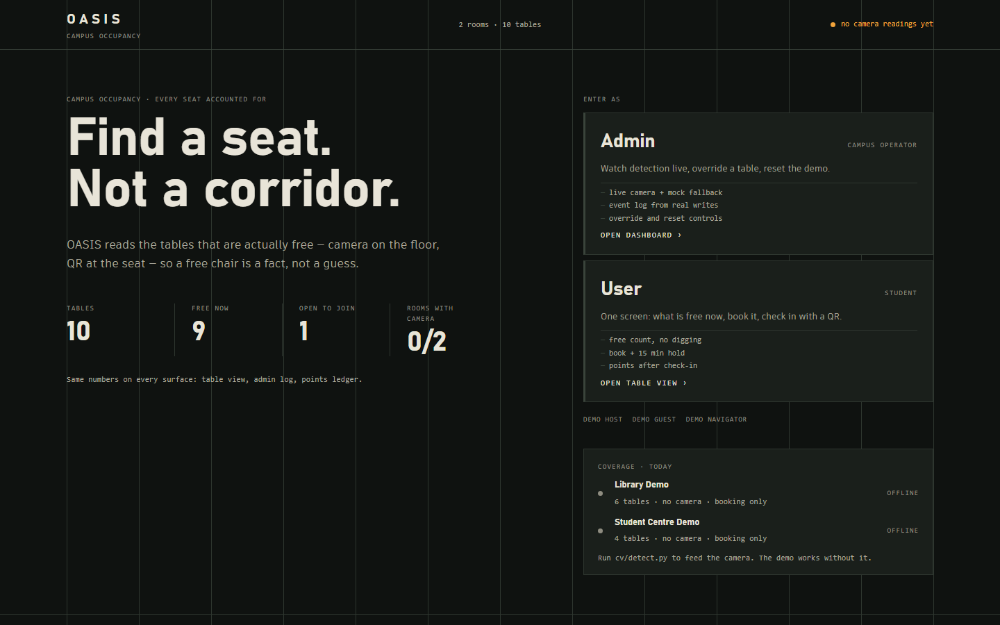
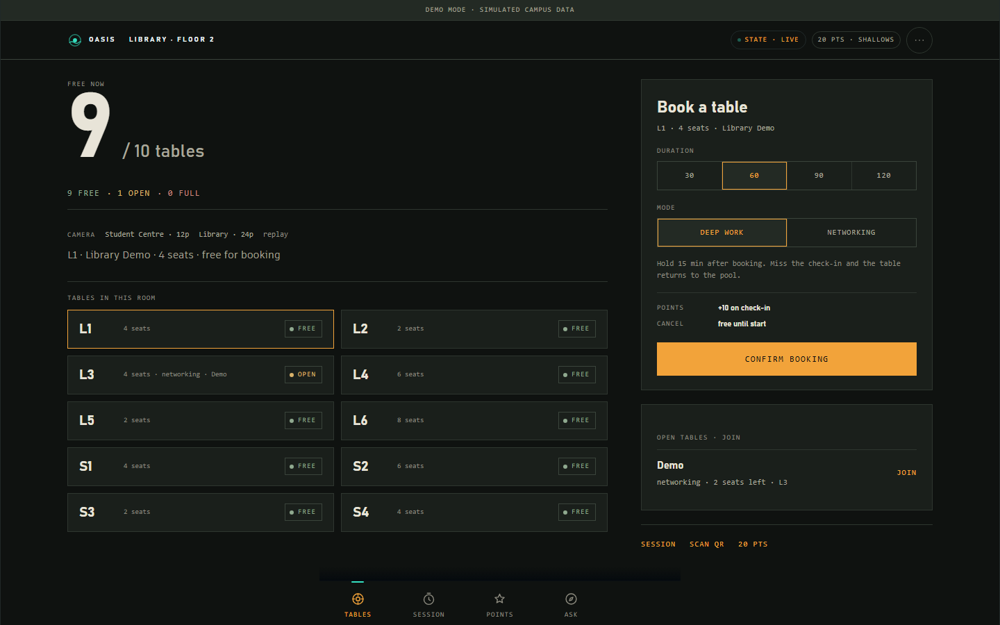
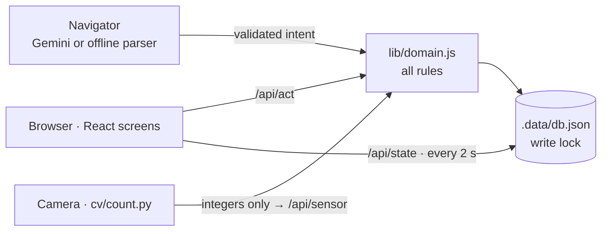

<p align="center">
  <picture>
    <source media="(prefers-color-scheme: dark)" srcset="public/brand/oasis-lockup-dark.svg">
    
  </picture>
</p>

<p align="center">
  <strong>Open Academic Space and Interaction System</strong><br>
  STACK 2026 · Case 1: Smarter Campus and Learning
</p>

<p align="center">
  
  
  
  
</p>

> **See it. Claim it. Share it.**
> A zero-install PWA that shows which coworking tables are free at UPNVJT, lets a student claim one in seconds, and helps them find study partners who work the same way.

<p align="center">
  
</p>

<p align="center">
  
  
</p>

This repository is the working MVP described by [`public/docs/OASIS_PRD_v3.md`](public/docs/OASIS_PRD_v3.md).

**Contents:** [Try it](#try-it-in-60-seconds) · [What works](#what-works) · [How it works](#how-it-works) · [Camera occupancy](#camera-occupancy-optional-edge-cv) · [Verify it](#verify-it) · [Configuration](#configuration) · [Deviations from the PRD](#deviations-from-the-prd) · [Honesty notes](#honesty-notes) · [Layout](#layout)

---

## Try it in 60 seconds

```bash
npm install
npm run dev          # http://localhost:3000
```

1. Open the landing page: it offers two entry points, **Admin** (camera monitoring) and **User** (find a table). No account and no API key needed.
2. As a student you land on a single screen: free tables, what the camera sees right now, the booking panel and the Navigator.
3. As an admin you land on the camera dashboard: the replay, per-table counts, the measured error and the event log.
4. Host, guest and navigator personas are one tap away on the login screen.

The demo campus is separate from the real campus rows and is always labelled “Demo mode · simulated campus data”.

### Demo personas

| Persona        | Tier / points  | Seeded state                                            |
|----------------|----------------|---------------------------------------------------------|
| Demo Seeker    | Shallows, 20   | no session                                              |
| Demo Host      | Reef, 120      | published Networking Open Table, 2 seats open, table L3 |
| Demo Guest     | Shallows, 35   | no session                                              |
| Demo Navigator | Deep Blue, 180 | no session                                              |
| Demo Admin     | Deep Blue, 2024 | no session; lands on `/admin`                          |

Switching personas keeps the demo state. **Reset demo** (top bar, demo only) rebuilds it. `GET /api/cron` re-seeds the demo when it goes stale, expires unchecked bookings and closes finished sessions: point a scheduler at it hourly.

---

## What works

**Find a table**
- Landing page, one-click demo login, demo banner, reset.
- **Student screen** (`/radar`): one page with the free-table count, a table grid carrying camera occupancy, the booking panel and the Navigator entry. Status is derived only from bookings, check-ins, walk-ins and reports, and always shown as icon + text + colour.
- **Admin dashboard** (`/admin`): the camera replay is the hero of the page, with per-table cards underneath (zone id, people seen, occupancy bar), the detection rail, pipeline metrics, the measured error and the event log. Camera tabs switch rooms.

**Claim it**
- Booking for 30–120 minutes, Deep Work or Networking, with Open Table (seat stepper, topic, note). Four taps from Radar to a reservation, with an Undo toast.
- QR check-in, Scan & Sit walk-in, 15-minute auto-release, a “Still here?” extend prompt, and I'm leaving / host close / host removes a guest.

**Share it**
- Join an Open Table: mode norms accepted in one tap, transactional seats (no overbooking). Guests see only the host's first name, programme and intake year.
- **Points:** append-only ledger, daily cap, tiers, priority tables at peak hours, three-miss perk pause, no deductions.

**Navigator (AI agent)**
- Structured intent from Gemini (when a key exists) or the deterministic offline parser.
- Live step trace, one clarifying question, a result card with Undo and scanner, a per-user rate limit, and off-topic requests are declined.

**Platform**
- PWA manifest, service-worker app shell, offline banner, reduced-motion support, dark/light via `prefers-color-scheme`.
- Google sign-in was dropped by team decision: the build enters through demo accounts only.

---

## How it works

Next.js App Router on the server, React client screens, one JSON document store at `.data/db.json` guarded by a write lock, and all domain rules in `lib/domain.js` executed server-side. The browser never computes points, seats or permissions: it calls `/api/act` and re-reads `/api/state` every 2 seconds. That is the whole of it.



[`public/docs/ARCHITECTURE.md`](public/docs/ARCHITECTURE.md) has the full diagram, invariants and the migration path to Supabase + Realtime.

### Interface

The UI is an instrument panel, not a marketing skin: ink surfaces, one phosphor-teal accent, hairline rules, mono data labels and tabular numerals, with Instrument Sans self-hosted from `public/fonts` (no webfont request, no layout shift).

- Status always carries icon, label and colour.
- On the admin page the camera is the largest element: a 16:9 replay, centred, with the analysis directly underneath rather than beside it.
- Table cards always carry the zone id, the count and a capacity bar, so a number can be traced back to a box in the picture.
- Booking is one sheet: duration segment, mode cards, a real switch, seat stepper, and a CTA that restates the deal.
- The session screen centres a countdown dial that turns amber, then red, as the check-in window closes.
- Light theme and reduced motion are handled with tokens.

Brand assets live in [`public/brand/`](public/brand): the mark, light and dark lockups, and 192/512 px icons.

---

## Camera occupancy (optional, edge CV)

A second source of truth for the Radar: a camera counts people per table and posts **integers only** to `/api/sensor`.

**Fusion rule**
- A free table that the camera sees occupied becomes `Seen occupied` and cannot be booked.
- A booked table keeps its booking status, so no-shows stay visible.
- A reading older than 90 s is ignored and the app falls back to booking-only truth.
- No frames, faces or identities leave the detector.

Full detail, training recipe and metrics: [`cv/README.md`](cv/README.md).

### Camera preview in the admin dashboard

Two cameras, both **replays**, switchable in the tile. Each is a 1280×726 h264 loop at 5 fps (1.3 MB library, 2.2 MB canteen, muted) plus a JSON timeline keyed by video time, so the table cards and the KPI row move with the picture instead of drifting from it.

| Camera    | Scene                                  | Footage                                                   |
|-----------|----------------------------------------|-----------------------------------------------------------|
| `library` | quiet study room, table boxes          | CDED-7 classroom CCTV (`class_3.mp4`)                     |
| `canteen` | busy Student Centre, long benches      | Pexels clip (`cv/media/cafeteria.mp4`)                    |

- **Licences:** CDED-7 (Zenodo DOI 10.5281/zenodo.21207208) is research/non-commercial, so it is demo material only and never redistributed. Video files stay out of git (`cv/media/` is ignored).
- **Table IDs** are assigned automatically by `cv/calibrate.py`, either by merging 40 frames into median boxes (real tables) or with `--grid-zones rows,cols` when the room is a grid of desks or benches (CDED-7 uses 2×3 desk blocks, the canteen 1×4). Zones, capacity and IDs land in `cv/tables/<camera>.json` as `T01..`.
- **Counting:** `cv/count.py` tracks people (ByteTrack), assigns each track to the nearest table *rectangle* within reach (not the centroid, which misfires on wide cells), smooths the count with a 10-sample median, and writes `public/cam/<camera>.json` plus an annotated mp4.
- **Accuracy is measured, not asserted:** `cv/eval_mae.py` scores per-table counts against CDED-7's own annotations, and the admin tile prints the result (`±1.5 people/table, 534 table-samples`).
- **Training** of the person-heavy model runs on Colab/Kaggle: `cv/train_colab.ipynb` (yolo11s, imgsz 960, 100 epochs, patience 30) exports `best.pt` back into `cv/runs/tables/weights/`.
- The overlay is baked in by `cv/count.py`: zone plates with `T0x Lx Np`, person boxes and track ids, drawn on the counted frames before encoding.
- The tile labels itself **replay**, never “live camera”: there is no camera in the room during judging.

<details>
<summary>Rebuild the canteen preview</summary>

```bash
# canteen: 1x4 grid over the benches
python cv/calibrate.py --source cv/media/cafeteria.mp4 --grid-zones 1,4 \
  --camera-id cam-canteen-1 --space "Student Centre" --labels S1,S2,S3,S4 \
  --capacity 4,6,2,4
python cv/count.py --source cv/media/cafeteria.mp4 --tables cv/tables/cam-canteen-1.json \
  --out public/cam/canteen.json --annotate cv/media/canteen-counted.mp4 --max-seconds 21
node scripts/build-cam.mjs

# library: CDED-7 classroom, 2x3 desk blocks, scored against its own annotations
python cv/calibrate.py --source cv/media/cded7/videos/class_3.mp4 --grid-zones 2,3 \
  --camera-id cam-library-1 --space "Library" --labels L1,L2,L3,L4,L5,L6 --capacity 6
python cv/count.py --source cv/media/cded7/videos/class_3.mp4 --tables cv/tables/cam-library-1.json \
  --out public/cam/library.json --annotate cv/media/cded-counted.mp4 --max-seconds 18
python cv/eval_mae.py --video class_3 --tables cv/tables/cam-library-1.json \
  --timeline public/cam/library.json --out public/cam/mae-library.json
```

Run one camera at a time: both scripts write `cv/tables/` and `public/cam/` without a lock.


</details>

---

## Verify it

```bash
npm run test:unit        # rule-level checks, no server: node scripts/unit.mjs
npm run dev              # then, in another shell:
npm run test:smoke       # API journeys against localhost:3000
npm run test:ui          # browser checks in headless Chrome (UI flows)
npm run test:rehearsal   # PRD D9: 20 demo logins + 10 Navigator runs
```

Measured on the production build (`npm run build && npm start`), 1 Nov 2026, on the development machine:

| Check                        | Result                                                                                                   |
|------------------------------|----------------------------------------------------------------------------------------------------------|
| `test:unit`                  | 20/20                                                                                                    |
| `test:smoke`                 | 32/32                                                                                                    |
| `test:ui`                    | 35/35 across landing, user (camera line), admin (both replays, zone ids, accuracy line) and 390 px mobile |
| `test:rehearsal`             | 20/20 demo logins, 10/10 Navigator bookings, median 60 ms per two-prompt run (offline parser)             |

`scripts/smoke.mjs` exercises login, booking, joining, norms, overbooking, check-in, points, release, walk-in, the two-report badge, Navigator clarification and Undo, QR rendering and reset. `scripts/ui-check.mjs` drives headless Chrome over CDP; set `CHROME_PATH` if Chrome is not in the default Windows location.

---

## Configuration

Optional environment variables in `.env.local` (see `.env.example`):

| Variable         | Purpose                                                                              |
|------------------|--------------------------------------------------------------------------------------|
| `GEMINI_API_KEY` | Enables the Gemini-backed Navigator. Without it the labelled offline parser answers. |
| `GEMINI_MODEL`   | Defaults to `gemini-2.0-flash`.                                                      |

Secrets never reach the browser: the Gemini key is read in a route handler only.

---

## Deviations from the PRD

An honest list of where the shipped build differs from the plan, and why.

| PRD                                                                             | Shipped                                                                                                          | Why                                                                                                                         |
|---------------------------------------------------------------------------------|------------------------------------------------------------------------------------------------------------------|-----------------------------------------------------------------------------------------------------------------------------|
| Supabase Postgres + RLS + Edge Functions                                        | JSON file store + route handlers with a write lock; `supabase/schema.sql` holds the target schema                | No Supabase project or card available in this build; the rules and API shape are the same, and the schema is ready to move. |
| Supabase Realtime                                                               | 2-second polling with an “updated Ns ago” label                                                                  | Same user-visible behaviour at pilot scale without a second service.                                                        |
| Gemini function calling loop (4 tools)                                          | Gemini returns a validated structured intent; the same allowlisted server actions execute it                     | Fewer round trips, same guarantee: no booking without a validated intent, the model never writes SQL.                       |
| Navigator tools named `search_tables`, `book_table`, …                          | Implemented as server functions of the same names in `lib/navigator.js`                                          | Behaviour matches; only the transport differs.                                                                              |
| Hourly `pg_cron` jobs                                                           | `GET /api/cron` (any scheduler) + re-seed on demo login                                                          | Free-tier friendly; a GitHub Actions workflow is included.                                                                  |
| Institutional Google sign-in                                                    | Demo accounts only, by team decision                                                                             | Faster path to a working demo; the PRD keeps campus auth as the production step.                                            |
| Leaderboard, Bahasa UI toggle, voice input, rotating QR, course recommendations | Not built                                                                                                        | Could-have items in the PRD.                                                                                                |
| Web Push notifications                                                          | In-app state only                                                                                                | iOS support needs an installed PWA; notifications were not on the critical path.                                            |
| N8 pre-filled quick-booking form when the AI fails                              | The Navigator returns validated alternatives and the normal booking sheet, with a free Undo                      | Same recovery, fewer moving parts; nothing books without a tap.                                                             |
| P3 host points limited to the same pair twice a day                             | Host bonus is awarded once per guest check-in, guarded by the ledger; per-pair daily counting is not implemented | The daily cap and the one-award-per-booking guard cover the demo risk.                                                      |

**Known limitation carried over from the PRD:** a static table QR can be photographed. Scans are bound to an active booking and one session per user, and the two-report rule covers the gap until rotating codes ship. Demo tables publish their QR token in the app so a judge can check in without a printed code; real campus tables never do.

---

## Honesty notes

- Metrics in `public/docs/OASIS_PRD_v3.md` are **targets**. No baseline, pilot or Lighthouse numbers are claimed beyond those measured above.
- Every demo screen is labelled simulated data. Nothing seeded is presented as a real campus result.
- Google sign-in is not in this build: the team decided the demo login is enough for the submission.
- Navigator: the hosted model is called only when `GEMINI_API_KEY` is set. Without a key the local parser answers deterministically and the UI says so.
- The admin camera tile is a replay of third-party footage, labelled as such.

---

## Layout

```
app/            routes: landing, login, radar, navigator, scan, session, points, /api/*
components/     client screens and the shared state provider
lib/            store, seed, domain rules, auth, navigator, view models
cv/             detection, calibration, counting, evaluation, training notebook
scripts/        unit.mjs, smoke.mjs, ui-check.mjs
public/brand/   logo mark, lockups and PWA icons
public/docs/screens/  screenshots used by this README
public/docs/    PRD v3 and ARCHITECTURE.md
supabase/       target schema and RLS policies
.data/          runtime database (git-ignored)
```

---

<p align="center">
  <sub>Built for STACK 2026 · UPNVJT</sub>
</p>
